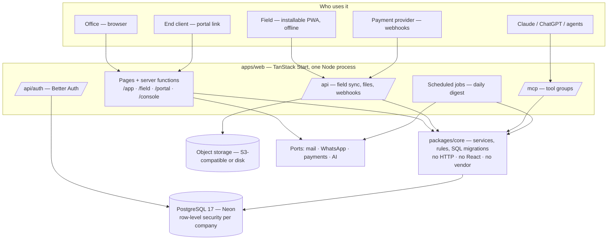
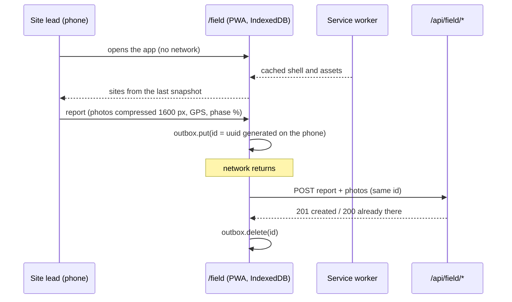

# Architecture

Struo is one core and several thin doors, in one TanStack Start application (constitution II).



## Isolation between companies

```mermaid
sequenceDiagram
  participant W as Door (page, API, MCP)
  participant C as core
  participant DB as PostgreSQL (role struo_app, NOBYPASSRLS)
  W->>C: actor = resolveActor(user, company)
  C->>DB: begin; set_config('struo.user_id', user)
  C->>DB: select … from project where org_id = $company
  Note over DB: policy: struo_is_member(org_id)<br/>→ only companies the user belongs to
  DB-->>C: rows of that company only
  C->>DB: insert into journal (who, what, before, after, door)
  C->>DB: commit
```

- Every company table has `org_id` and a policy `struo_is_member(org_id)` created in the same
  migration. A test fails if a table with `org_id` lacks row-level security.
- The application connects as `struo_app` (no `BYPASSRLS`, not superuser). The owner connection is
  used only for migrations, the platform console, the subscription payment webhooks, the
  client portal and the daily jobs — each scoped explicitly.
- The end-client portal has no account: a token (only its SHA-256 hash is stored) opens
  `security definer` SQL functions that return that one project.
- An MCP/API key (hash stored) acts as its creator, with their current role, in its company.

## Money

Amounts are `bigint` minor units with an ISO 4217 currency; rates are basis points. VAT, totals,
retention and net of an invoice are **generated columns**; balances, aging, margins and health are
SQL views (`invoice_balance`, `project_finance`, `project_progress`). The browser never computes a
total.

```mermaid
flowchart LR
  A[amount_minor HT] --> V[vat_minor = round(amount × vat_bps / 10000)]
  A --> T[total_minor = amount + vat]
  V --> T
  T --> R[retention_minor = round(total × retention_bps / 10000)]
  T --> N[net_minor = total − retention − deduction]
  R --> N
  N --> B[invoice_balance: paid, balance, overdue_days]
  B --> PF[project_finance: invoiced, collected, overdue, health]
```

## Field app offline



The report's progress becomes the phase's progress only when an engineer validates it.

## Layout

```
packages/core/src/       access (roles, journal) · orgs · projects · field · finance · documents
                         expenses · planning · alerts · portal · apikeys · saas · ports · money
packages/core/db/migrations/   0001 foundation … 0006 portal, MCP, alerts
apps/web/src/routes/     pages and HTTP handlers (thin)
apps/web/src/features/   server functions per area, MCP server, field store
apps/web/src/server/     runtime (pools, auth), adapters (storage, mail, WhatsApp, AI, Moneroo), jobs
apps/web/src/i18n/       fr.ts (reference) and en.ts, typed keys
```

## Deployment

One Docker image (`Dockerfile`): `start.mjs` applies pending migrations with the owner connection,
gives `struo_app` its password, then starts the server. CI (`.github/workflows/ci.yml`) runs the
build, typecheck and tests against a throw-away PostgreSQL, scans for secrets (gitleaks), publishes
the image to GHCR on `dev` and `main`, and asks Coolify to redeploy when configured.
