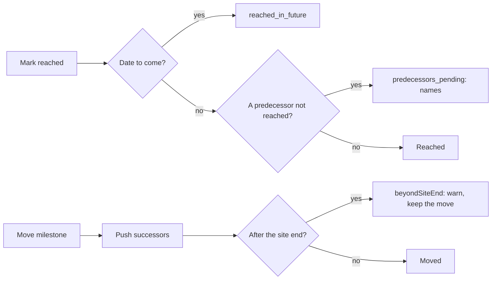

# 085 — What a site tested end to end through MCP revealed

**Branch**: `085-mcp-test-fixes` (base `dev`) · **Status**: delivered for review

A test site (client, planning, phases, invoice draft, expenses, supplier bills, incident) was driven
through the MCP door to find what lets wrong data in, or refuses without saying why. Each fix lives in
`packages/core`, so the screens, the assistant and MCP get it alike; `packages/core/tests/integrity.test.ts`
holds one test per fix.

## Planning

- **A milestone is reached only after those it waits for** (`predecessors_pending`, which names them),
  and never on a date still to come (`reached_in_future`). The reception could be marked done while the
  foundations were still ahead.
- **A cascade that pushes milestones past the site's planned end says so.** `moveMilestone` keeps the
  move and returns `beyondSiteEnd`; the planning page shows it after the « undo » toast, and MCP tells
  the model to tell the person.
- Back to « not reached » is refused while a milestone waiting for it is reached (`successors_reached`).
- `markMilestoneReached` (core) dates « today » in the company's time zone.

## Dates

- **An end before the start** of a site or a phase is refused as `end_before_start` (it used to reach
  the database check and come back as « generic »).
- **« Today » is the company's day.** `orgToday` (core) reads `org_settings.time_zone`; invoices,
  drafts, payments, expenses and supplier bills default to it instead of the server's UTC day. In the
  browser, `todayIso` (ui) gives the person's local day instead of the UTC one.
- **Every SQL `current_date` is the company's day.** `asActor` sets the transaction's `TimeZone` to the
  company's, so overdue invoices, the cash forecast and the indicators turn the day at the company's
  midnight, not the server's.

## Money

- **An expense cannot be dated in the future** (`spent_in_future`); paying a supplier bill on a day to
  come is refused the same way, since paying records an expense. A future expense counted in margins,
  cash and the forecast's pace before it happened.
- **The same supplier bill twice is refused** (`bill_duplicate`): same supplier and reference, any case,
  unless the first is cancelled. A supplier bill due before its issue date is refused (`due_before_issue`).
- **A payment cannot exceed what is left on its invoice** (`payment_exceeds_balance`, which gives the
  balance) nor be dated in the future (`received_in_future`). An overpayment showed a balance of 0 while
  counting the extra as collected. The invoice row is locked while the payment is checked, so two
  payments entered at once cannot both fit the same balance.

## MCP and the assistant

- **The preview shows the refusal.** A capability may declare `check`, run before its preview: a
  duplicated site code, dates out of order, an unknown client, an invoice due before its issue date or a
  deduction above the amount including VAT now answer an error instead of a preview bound to fail after
  the « yes ». Core gives `checkNewProject` and `checkNewInvoice`, the same tests as the writes.
- **MCP tells the client like the screens do.** `issue_invoice` and `mark_milestone_reached` now send
  the same client notification as the office (spec 051). `mark_milestone_reached` therefore moves to level
  3: a preview first (refused there already when a predecessor is pending), then the person's « yes ».
- **A client's payment declaration is confirmed once.** `confirmPaymentClaim` checks, records the payment
  and closes the claim in one transaction holding the claim's lock (`recordPaymentTx`); two confirmations
  at once used to both see « pending » and could record the money twice.
- **`update_site` attaches a client** (by name or id; an empty string detaches it).
- **A name is never guessed.** For `update_incident`'s assignee and every client name: the exact name
  wins, else the only name containing it; none is `member_not_found` / `not_found`, several is
  `member_ambiguous` / `client_ambiguous`. An unknown assignee used to clear the current one silently.

## Not changed (decisions for the product)

- Invoicing a site without a client stays possible.
- Phase budgets may exceed the site budget; progress is weighted by phase budgets.
- The company's average progress counts active sites only.
- The VAT presets per country are right (Senegal 18 %); a company's own rate is its setting.
