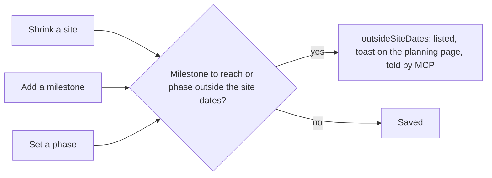

# 086 — The second round of MCP scenarios on the live site

**Branch**: `086-mcp-retest-fixes` (base `dev`) · **Status**: delivered for review

After 085 went live, six scenarios (clients, planning and phases, field, costs, invoicing previews,
indicators) were replayed through MCP on a test site. The 085 fixes held; these gaps showed up. Each is
fixed in `packages/core` and proven in `packages/core/tests/retest.test.ts`.

## Supplier bills

- **An overdue bill can be entered again** (a regression of 085). Without its own date, a bill is taken
  as issued today, or on its due date when that is already past: a bill received late is recorded, not
  refused as `due_before_issue`. MCP `add_supplier_bill` accepts the bill's own `issuedOn`.
- **Paying is checked on the preview.** `checkSupplierBillPayment` (core) refuses an unknown bill, a
  bill already paid or cancelled, and a day to come; MCP `pay_supplier_bill` runs it before its preview,
  which now shows the amount with its currency and the payment day.

## Payments received

- **The preview refuses what the payment would.** `checkNewPayment` (core) runs the same tests as
  `recordPayment`: the site, the invoice on that site, more than the balance, a day to come. MCP
  `record_payment` runs it before its preview.
- **A draft or a cancelled invoice says so** (`invoice_not_payable`), instead of « this invoice does not
  belong to the project ».

## Clients

- **Two clients cannot share a name** (`client_name_taken`), whatever the case, the accents or the
  surrounding spaces, on creation and on rename. The CSV import reuses a client by the same rule.
- **An unknown client on a site is `not_found`**, not the database's bare foreign-key error (`generic`).

## The site's window

A site can run late: nothing is refused, but what falls outside its dates is said back.

- `updateProject`, `addMilestone` and `updatePhase` return `outsideSiteDates` (`outsideSiteDates`
  in core lists them). MCP `update_site`, `add_milestone` and `set_phase` return it; the planning page
  shows « n planning item(s) now fall outside the site's dates ».
- The planning page showed every refusal as a generic error: it now shows the refusal's own text (an end
  before the start, a milestone that waits for another…).

## Indicators

- **No negative runway**: no cash left is a runway of 0 months, not « −3 ».
- **An expense dated ahead is not spent yet**: the monthly burn and the cash forecast's starting balance
  count expenses up to today only. (Such rows can no longer be written since 085; older ones remain.)

## Small ones

- The same predecessor named twice in a milestone's dependencies keeps its longest gap.
- MCP `prepare_invoice` refuses a priced line with a quantity of 0.

## Not changed

- Site totals (`project_finance`) still count every expense, whatever its date; rows dated ahead can only
  come from before 085.
- Two supplier bills without a reference cannot be told apart: both are kept.
